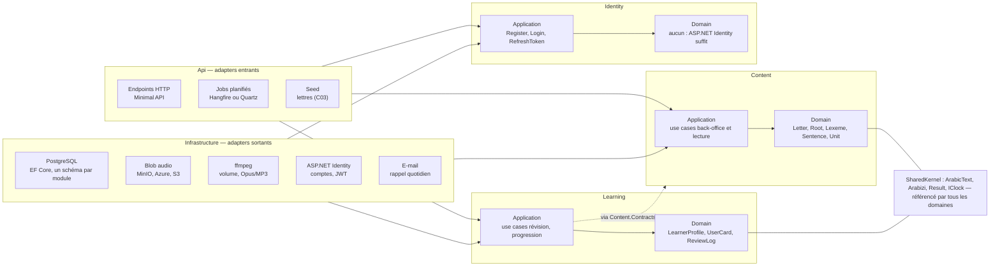

# Plan back-end

26 octobre 2026

Plan d'implémentation du back-end .NET en architecture hexagonale : un domaine sans dépendance technique, des ports (interfaces) qui le relient au monde, et des adapters (API, PostgreSQL, blob, auth, jobs) remplaçables. Trois modules indépendants, `Content`, `Learning` et `Identity`, dans un seul déployable.

## 1. Principes

La règle unique : **les dépendances pointent vers le domaine, jamais l'inverse.** Le domaine ne référence ni EF Core, ni ASP.NET, ni aucun SDK ; il ne connaît que ses propres types et les interfaces qu'il expose.

- **Domaine** (`Domain`) : entités, agrégats, value objects, règles métier, événements de domaine, services de domaine (normalisation arabe, scheduler FSRS). Testable sans aucune infrastructure.
- **Application** (`Application`) : les use cases, un par intention (`PublishLexeme`, `ReviewCard`). C'est là que vivent les **ports** : les ports *entrants* sont les use cases eux-mêmes, les ports *sortants* sont les interfaces dont ils ont besoin (`ILexemeRepository`, `IAudioStore`, `IClock`).
- **Adapters** : tout ce qui touche au monde. *Entrants* : l'API HTTP, les jobs planifiés, le seed. *Sortants* : PostgreSQL via EF Core, le stockage blob, le traitement audio, ASP.NET Identity, l'envoi d'e-mails.
- **Un hexagone par module.** `Content`, `Learning` et `Identity` ont chacun leur domaine, leurs ports et leurs adapters, et ne se parlent que par leurs ports publics ou par événements. Même déployable, mais frontières nettes : si un jour `Learning` doit sortir dans son propre service, rien dans le code ne s'y oppose.
- **Pas de framework au milieu.** Pas de médiateur générique : un endpoint injecte son use case et l'appelle. Moins de magie, plus lisible, et les use cases restent des classes ordinaires.
- **Composition à la racine.** Un seul projet `Api` compose les adapters et branche les ports, par module, au démarrage.

## 2. Vue d'ensemble



Les adapters d'entrée (à gauche) appellent les use cases ; les adapters de sortie (à droite) implémentent les ports déclarés dans l'application ; le domaine, au centre, ne dépend de rien. `Learning` ne lit le contenu publié qu'à travers `Content.Contracts`.

## 3. Structure de la solution

Une solution, un déployable (`Api`), trois modules à trois couches chacun, un noyau partagé minimal. Les flèches de dépendance : `Domain` → `SharedKernel` seulement ; `Application` → `Domain` ; `Infrastructure` → `Application` (elle implémente les ports) ; `Api` → tout, parce qu'elle compose.

```text
src/
  Api/                            composition root : endpoints, auth, jobs, seed
    Modules/Content/Endpoints/
    Modules/Learning/Endpoints/
    Modules/Identity/Endpoints/
  SharedKernel/                   ArabicText, Arabizi, Result<T>, IClock, DomainEvent
  Modules/
    Content/
      Content.Domain/             Letter, Root, Lexeme, Sentence, Unit ; règles ; événements
      Content.Application/        use cases ; ports sortants (ILexemeRepository, IAudioStore…)
      Content.Contracts/          ce que les autres modules peuvent voir : IPublishedContentReader, DTOs, événements
      Content.Infrastructure/     EF Core (schéma content), blob, ffmpeg
    Learning/
      Learning.Domain/            LearnerProfile, UserCard, ReviewLog, ExerciseAttempt ; scheduler ; AnswerChecker
      Learning.Application/       use cases ; ports sortants
      Learning.Infrastructure/    EF Core (schéma learning), e-mail
    Identity/
      Identity.Application/       Register, Login, RefreshToken ; ICurrentUser
      Identity.Infrastructure/    ASP.NET Identity (schéma identity), JWT
tests/
  Content.Domain.Tests/           unitaires purs, sans base
  Content.Application.Tests/      use cases avec fakes des ports
  Learning.Domain.Tests/          FSRS, AnswerChecker, streak
  Learning.Application.Tests/
  Api.IntegrationTests/           Testcontainers PostgreSQL, endpoints de bout en bout
  Architecture.Tests/             règles de dépendance (NetArchTest ou ArchUnitNET)
```

`Learning` ne référence jamais `Content.Domain` ni `Content.Infrastructure` : il passe par `Content.Contracts`. C'est la seule dépendance entre modules, et elle est à sens unique.

## 4. Domaine par module

### Noyau partagé

- `ArabicText` : value object construit en NFC, validé contre l'alphabet de la charte (28 lettres + ڨ ڤ پ, pas de harakat, pas de formes de présentation), avec une propriété `Normalized` (alifs unifiés, ى → ي, ة → ه, ق/ڨ selon la charte) servant aux comparaisons et à la recherche.
- `Arabizi` : chaîne latine validée (lettres, 7, 3, 9, tiret, apostrophe).
- `Variety` (`aeb`), `LoanOrigin` (fr, it, aucun), `AudioRef` (clé blob + durée), `ContentStatus` (brouillon, publié).
- `Result<T>` et erreurs typées (`NotFound`, `Validation`, `Conflict`, `Forbidden`) ; `IClock` ; `DomainEvent` de base.

### Content

| Agrégat | Contenu | Règles |
| --- | --- | --- |
| `Letter` | code, quatre formes, groupe de forme, ordre d'enseignement, `extended`, mot d'exemple, audio | données de référence, modifiables mais jamais supprimées |
| `Root` | trois ou quatre radicales, sens | unicité des radicales |
| `Lexeme` | `ArabicText`, `Arabizi`, français, catégorie, racine, schème, genre, pluriel, `Variety`, `LoanOrigin`, audio, statut | publication refusée sans audio, français et arabizi ; `arabic` normalisé à la saisie ; unicité (arabic normalisé, catégorie) |
| `Sentence` | arabe, arabizi, français, audio, lexèmes référencés, statut | publication refusée si un lexème référencé n'est pas publié |
| `Unit` → `Lesson` → `LessonItem` / `Exercise` | unité ordonnée, leçons ordonnées, items (lexème ou phrase), exercices (type + charge `jsonb`) | publication refusée si un item n'est pas publié ; exercices générés par défaut puis éditables |

Événements : `LexemePublished`, `SentencePublished`, `UnitPublished`, `AudioAttached`.

### Learning

| Agrégat | Contenu | Règles |
| --- | --- | --- |
| `LearnerProfile` | objectif quotidien, nouvelles cartes par jour, série, XP, dernière activité, progression par lettre et par unité | la série monte quand l'objectif du jour est atteint, tombe après un jour sans activité |
| `UserCard` | apprenant, référence (lettre, lexème ou phrase), état FSRS (`stability`, `difficulty`, `due`, `reps`, `lapses`, `state`), dernière revue | `Review(rating, now)` délègue au scheduler et produit une entrée de `ReviewLog` ; une carte par (apprenant, référence) |
| `ReviewLog` | carte, note (1 à 4), date, état avant / après | append-only, jamais modifié |
| `ExerciseAttempt` | apprenant, exercice, réponse brute, réponse normalisée, correct, date | append-only |

Services de domaine : `IReviewScheduler` (FSRS) et `AnswerChecker` (compare les `Normalized`, tolère la ponctuation et les espaces). Événements : `CardReviewed`, `UnitStarted`, `DailyGoalReached`.

### Identity

Pas de domaine propre : l'utilisateur ASP.NET Identity, deux rôles (`learner`, `admin`), et le port `ICurrentUser` exposé aux autres modules.

## 5. Ports et adapters

Chaque port est une interface déclarée dans `Application` (ou `Contracts` pour les ports inter-modules) ; l'adapter vit dans `Infrastructure` ou `Api` et n'est connu que de la racine de composition. En test, chaque port sortant a un fake en mémoire.

| Port | Sens | Module | Adapter |
| --- | --- | --- | --- |
| Use cases (une classe par intention, `ExecuteAsync(input)`) | entrant | tous | endpoints Minimal API, jobs, seed |
| `ILetterRepository`, `IRootRepository`, `ILexemeRepository`, `ISentenceRepository`, `IUnitRepository` | sortant | Content | EF Core + Npgsql, schéma `content` |
| `IPublishedContentReader` (catalogue, unité publiée, items d'une leçon) | sortant, inter-modules | Content.Contracts → Learning | requête EF sur le schéma `content`, lecture seule |
| `IAudioStore` (put, get, delete, URL signée) | sortant | Content | MinIO en local, Azure Blob ou S3 en prod |
| `IAudioProcessor` (normaliser le volume, encoder Opus / MP3) | sortant | Content | ffmpeg lancé en processus |
| `ILearnerProfileRepository`, `IUserCardRepository`, `IReviewLogRepository`, `IExerciseAttemptRepository` | sortant | Learning | EF Core, schéma `learning` |
| `IReviewScheduler` (FSRS) | sortant | Learning | port .NET de py-fsrs, ou implémentation maison |
| `IEmailSender` | sortant | Learning (G03) | SMTP ou API transactionnelle |
| `ICurrentUser` | sortant | tous | `ClaimsPrincipal` de la requête |
| `IClock` | sortant | tous | horloge système ; fake en test |
| `IUnitOfWork` | sortant | tous | `SaveChanges` + transaction du DbContext du module |
| `IDomainEventDispatcher` | sortant | tous | en mémoire, dans la transaction ; outbox plus tard |
| Jobs planifiés (`SendDailyReminder`) | entrant | Learning | Hangfire ou Quartz, appelle un use case |

## 6. Use cases du MVP

Un use case = une classe, un input, un `Result<T>`. Les IDs renvoient aux stories du backlog.

### Content, back-office

- Lettres : `ListLetters`, `UpdateLetter` (C03, A02).
- Racines : `CreateRoot`, `ListRoots` (A02).
- Lexèmes : `CreateLexeme`, `UpdateLexeme`, `AttachAudio`, `PublishLexeme`, `SearchLexemes` (A01, A02, A03, A06).
- Phrases : `CreateSentence`, `UpdateSentence`, `AttachAudio`, `PublishSentence`, `SearchSentences` (A01 à A03, A06).
- Unités : `CreateUnit`, `AddLesson`, `SetLessonItems`, `GenerateDefaultExercises`, `UpdateExercise`, `PublishUnit`, `PreviewUnit` (A04).
- Qualité : `GetMissingContentReport` (A06) ; `ExportPublishedContent` (C04).

### Content, lecture apprenant

- `GetPublishedAlphabet` (L01, L02), `GetUnitCatalog` et `GetPublishedUnit` (P01), `GetLessonExercises` (X01).

### Learning

- `StartUnit` : crée les `UserCard` des items, dans la limite quotidienne (S04).
- `GetTodayQueue` (S02), `ReviewCard` (S01, S02, S03).
- `SubmitExerciseAttempt` : corrige via `AnswerChecker`, enregistre, crédite l'XP (X01 à X05).
- `RecordLetterProgress` (L03, L05), `SetDailyGoal`, `GetDashboard` (G01), `GetProgressOverview` (G02).
- `SendDailyReminder`, déclenché par job (G03).

### Identity

- `Register`, `Login`, `RefreshToken`, `PromoteToAdmin` (T03).

## 7. Transversal

- **Normalisation arabe** : une seule implémentation, `ArabicText.Normalized`, dans le noyau partagé, avec les règles de la charte en tests paramétrés (T06). Utilisée à la saisie (on stocke la forme brute et la forme normalisée), à la correction (`AnswerChecker`) et à la recherche (index sur la colonne normalisée).
- **Validation** : la forme des entrées à la frontière de l'application (validateurs FluentValidation ou faits main) ; les invariants métier dans le domaine, qui refuse un état invalide par `Result` plutôt que par exception.
- **Erreurs** : `Result<T>` avec erreurs typées, converties en `ProblemDetails` par l'API (404, 400, 409, 403). Les exceptions sont réservées aux bugs et aux pannes.
- **Transactions** : un use case = une transaction, ouverte et validée par `IUnitOfWork` dans un décorateur commun ; les événements de domaine sont dispatchés avant le commit, en mémoire. Un outbox n'est nécessaire que si un consommateur externe apparaît.
- **Persistance** : un `DbContext` par module, un schéma PostgreSQL par module (`content`, `learning`, `identity`) dans la même base, migrations séparées. Value objects en conversions EF, charge d'exercice en `jsonb`, index sur `(arabic_normalized, pos)`.
- **Sécurité** : JWT court + refresh token, rôle `admin` exigé sur tout le groupe d'endpoints back-office, CORS limité au front, secrets hors dépôt (user-secrets en local, variables d'environnement en prod), limitation de débit sur l'auth.
- **Observabilité** : Serilog structuré, OpenTelemetry (traces HTTP et EF), health checks (`/health`, base et blob).
- **Tests** : domaine en unitaire pur ; use cases avec fakes des ports ; API en intégration sur PostgreSQL via Testcontainers ; tests d'architecture qui échouent si `Domain` référence autre chose que `SharedKernel` ou si `Learning` touche `Content.Domain`.

## 8. Ordre d'implémentation

Aligné sur les jalons du backlog ; chaque étape laisse une API testable.

1. **M0 Socle.** `SharedKernel` (`ArabicText`, `Arabizi`, `Result`, `IClock`) avec ses tests ; squelette des trois modules et `Architecture.Tests` qui verrouillent les dépendances dès le premier jour ; `DbContext`, schémas et migrations ; Identity + JWT ; `IAudioStore` avec MinIO en local ; seed des 31 lettres. (T01, T03, T04, T06, C01, C03, T05)
2. **M1 Back-office.** `Content.Domain` complet ; use cases de saisie, d'audio et de publication ; endpoints admin ; `IAudioProcessor` ffmpeg ; rapport « ce qui manque » ; export JSON. (C02, C04, A01 à A06 côté API)
3. **M2 Lecture.** Endpoints publiés (alphabet, catalogue, unité) via `Content.Contracts` ; `LearnerProfile` et progression par lettre. (L01 à L03, L05 côté API)
4. **M3 SRS.** `UserCard`, `ReviewLog`, `IReviewScheduler` ; `StartUnit`, `GetTodayQueue`, `ReviewCard`. (S01 à S04, P01)
5. **M4 Exercices et progression.** `ExerciseAttempt`, `AnswerChecker`, `SubmitExerciseAttempt` ; objectif, série, XP, `GetDashboard`. (X01 à X05, G01)
6. **M5 Bêta.** Tests d'intégration de bout en bout, observabilité, durcissement (CORS, débit, secrets), rappel e-mail si le temps le permet. (Q01, G03)

## 9. Décisions techniques à trancher

| Décision | Options | Recommandation |
| --- | --- | --- |
| Version de .NET | .NET 10 (LTS) ou .NET 9 | .NET 10 |
| Style d'API | Minimal APIs groupées par module, ou contrôleurs | Minimal APIs, un `MapGroup` par module |
| Appel des use cases | injection directe dans l'endpoint, ou médiateur | injection directe ; MediatR est passé sous licence commerciale en 2025 et n'apporte rien ici |
| FSRS | port .NET de py-fsrs ([FsrsSharp](https://www.nuget.org/packages/FsrsSharp), [Fsrs.Sharp](https://www.nuget.org/packages/Fsrs.Sharp), [FSRS.Core](https://www.nuget.org/packages/fsrs.core)), ou implémentation maison | démarrer avec FsrsSharp derrière `IReviewScheduler`, basculer en maison si la bibliothèque n'est pas maintenue |
| Stockage audio | MinIO (API S3) en local, Azure Blob ou S3 en prod | MinIO partout en dev, choix prod selon l'hébergeur, les deux derrière `IAudioStore` |
| Traitement audio | ffmpeg en processus, ou bibliothèque managée | ffmpeg, encodage Opus + repli MP3 pour Safari |
| Jobs | Hangfire (tableau de bord) ou Quartz | à décider seulement si G03 entre dans le MVP |
| DbContext | un par module ou un seul | un par module, même base, un schéma chacun |
| Événements | en mémoire ou outbox | en mémoire pour le MVP |
| Hébergement | conteneur unique (API + PostgreSQL + MinIO en compose) sur un VPS, ou PaaS | compose sur VPS pour la bêta, à revoir avant ouverture |
